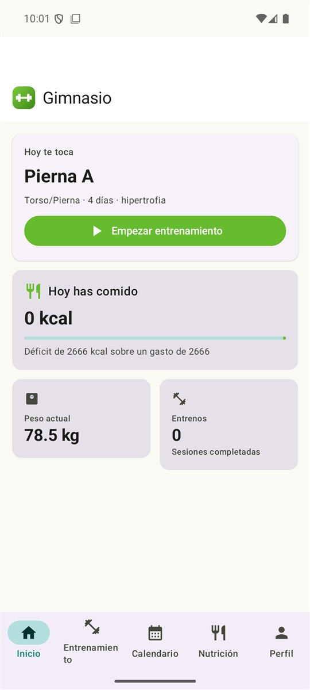
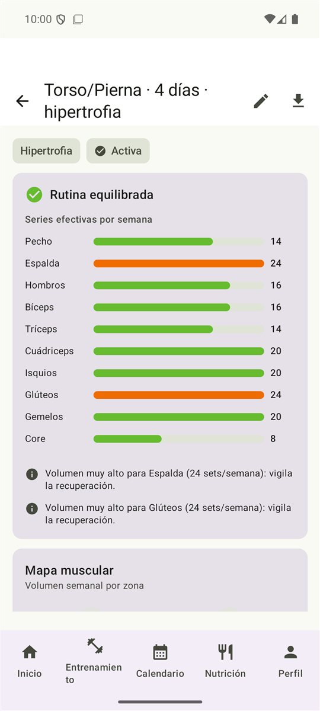
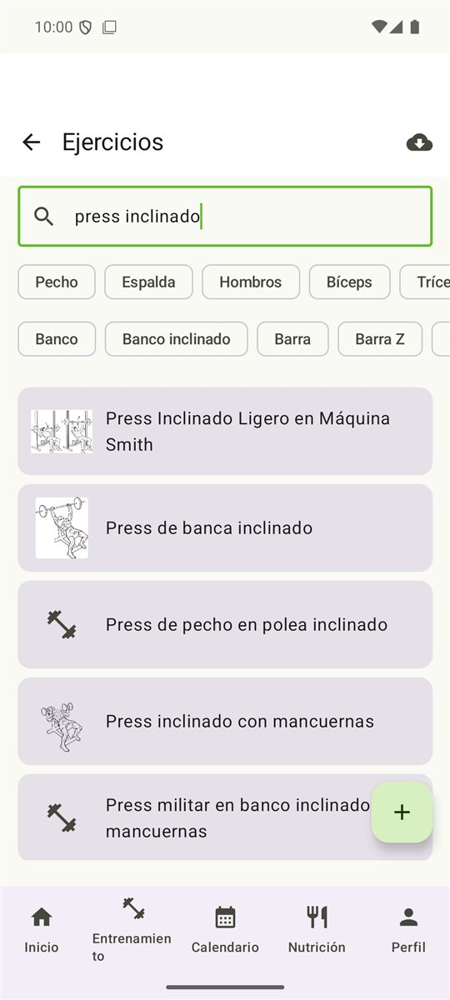
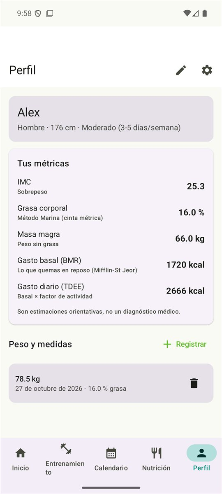

# Gimnasio

App de gimnasio y nutrición para Android. Registra entrenamientos, avisa cuando
una rutina deja músculos sin trabajar y lleva la cuenta de lo que comes frente a
lo que gastas.

**Todo se guarda en el móvil.** No hay cuentas, ni servidor, ni telemetría: la
base de datos es un fichero SQLite local y funciona sin conexión salvo cuando se
busca un ejercicio o un alimento nuevo.

## Capturas

| Inicio | Equilibrio muscular | Catálogo | Perfil |
|---|---|---|---|
|  |  |  |  |

## Qué hace

**Entrenamiento**

- Catálogo de ~830 ejercicios con imágenes, instrucciones en español y músculos
  implicados, descargado de [wger](https://wger.de) y guardado en local. La
  búsqueda va por palabras sueltas y sin importar mayúsculas ni tildes: "press
  inclinado" encuentra "Press de banca inclinado", y "elevacion" encuentra
  "Elevación lateral". Desde el buscador se puede abrir la ficha del ejercicio
  —fotos, músculos, material e instrucciones— antes de añadirlo a la rutina.
- Rutinas por días con **análisis de equilibrio muscular**: calcula las series
  efectivas por grupo a la semana (los músculos primarios cuentan el doble que
  los secundarios) y avisa si falta un grupo, si va escaso o si hay
  descompensación entre empuje y tirón o entre tren superior y piernas. Además
  del aviso propone **qué ejercicio añadir y en qué día**, o **qué cambiar por
  qué** cuando a un grupo le sobra volumen y a otro le falta, y lo aplica de un
  toque.
- Los días se pueden **copiar a otra rutina** con sus ejercicios, series y
  descansos, para reaprovechar un día bien montado sin rehacerlo.
- **Generador automático** de rutinas equilibradas según los días que entrenes,
  el tiempo que tengas por sesión, tu nivel, tu objetivo y el material del que
  dispongas. El tiempo decide cuántos ejercicios caben —recortando antes el
  aislamiento que los compuestos— y el nivel decide cuáles: a quien empieza no le
  propone cargadas ni buenos días, le da menos series y le monta cuerpo completo
  en vez de una división por patrones. Las rutinas se pueden duplicar para
  ajustarlas sin perder la anterior.
- Registro de series con peso y repeticiones, o con tiempo. Prerrellena lo que
  hiciste la vez anterior, y lo apuntado se puede corregir después: un peso mal
  tecleado no se queda envenenando las gráficas para siempre.
- Notas por sesión, para dejar constancia de lo que luego explica un bajón.
- **Cronómetro de descanso** que avisa con notificación y vibración aunque salgas
  de la app o el sistema la cierre, porque el aviso lo programa Android.
- **Progresión automática**: si completas el rango objetivo dos sesiones
  seguidas, propone subir el peso.
- Calendario mensual, mapa muscular sobre una silueta humana (de frente y de
  espalda, con cada zona teñida según su volumen semanal), gráficas de progreso
  por ejercicio, rachas
  por semanas y logros.

**Nutrición**

- Diario por comidas con el balance del día: lo que comes frente a tu gasto
  basal más lo que quemas entrenando.
- Búsqueda de alimentos en [Open Food Facts](https://openfoodfacts.org) y
  **escáner de código de barras**.
- Recetas propias, que calculan las calorías y macros por ración.
- Planes de dieta con objetivos de calorías y macros, aplicables al diario de un
  día con un toque.

**Perfil**

- IMC, porcentaje de grasa (método de la Marina si apuntas cuello y cintura, o
  estimación por IMC), gasto basal por Mifflin-St Jeor y gasto diario total.
- Gasto calórico de cada entrenamiento calculado por METs.
- Copia de seguridad completa en JSON y exportación a CSV.

## Cómo compilarla

Hace falta un JDK 21 y el SDK de Android (API 36). El resto lo baja Gradle.

```bash
./gradlew :composeApp:assembleDebug
```

El APK queda en `composeApp/build/outputs/apk/debug/`. Para instalarlo en un
móvil conectado por USB con la depuración activada:

```bash
./gradlew :composeApp:installDebug
```

Al abrir la app por primera vez, ve a **Entrenamiento → Catálogo de ejercicios**
y pulsa «Descargar catálogo»: casi todo lo demás depende de eso.

## Tecnología

Kotlin Multiplatform con Compose Multiplatform. Android es el objetivo real; los
targets de iOS están declarados y el código común compila para ellos, pero
todavía no hay proyecto de Xcode.

| Área | Elección |
|---|---|
| UI | Compose Multiplatform, Material 3 |
| Base de datos | SQLDelight sobre SQLite |
| Red | Ktor + kotlinx.serialization |
| Inyección de dependencias | Koin |
| Imágenes | Coil 3 |
| Avisos | AlarmManager (descansos) y WorkManager (recordatorios) |

## Tests

```bash
./gradlew :composeApp:testDebugUnitTest
```

Más de 220 tests. Los de repositorio corren contra SQLite de verdad, no contra
imitaciones, y los de interfaz con Robolectric, sin necesidad de emulador. Hay
además una red de seguridad que rompe el build si el esquema de la base de datos
cambia sin su migración correspondiente, para que una actualización no deje la
app instalada sin poder abrirse.

El código de iOS se verifica en cualquier sistema con el compilador de metadatos:

```bash
./gradlew :composeApp:compileIosMainKotlinMetadata
```

## Créditos

El catálogo de ejercicios viene de [wger](https://wger.de) y los datos
nutricionales de [Open Food Facts](https://openfoodfacts.org), ambos proyectos
abiertos y gratuitos.

Las estimaciones de composición corporal y de gasto calórico son orientativas y
no sustituyen a un profesional.
